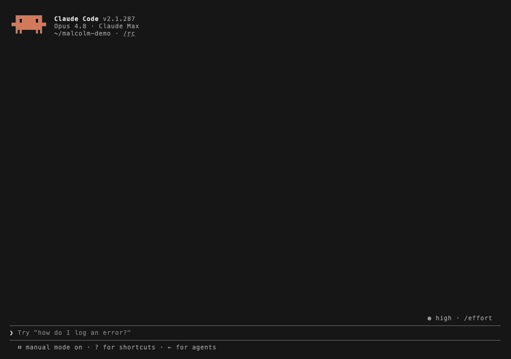

# Usage

## Demo

<details>
<summary>Recorded Claude Code session</summary>



An unedited Claude Code session against Malcolm's public training instance (training.malcolm.fyi): two `malcolm_aggregate` calls, then the answer. Claude Code ran in `--verbose` mode so each tool call is shown. By default it folds them into one "Calling malcolm" line.

</details>

## Malcolm filter syntax

Malcolm uses a simple JSON filter syntax, not OpenSearch DSL:

```python
# Exact match
{"event.dataset": "conn"}

# Multiple values (OR)
{"network.direction": ["inbound", "outbound"]}

# Negation
{"!network.transport": "icmp"}

# Field must exist (not null)
{"!related.password": null}

# Combined (AND)
{"event.dataset": "dns", "source.ip": "192.0.2.77"}
```

Values match **exactly**. Malcolm compiles this dict to an OpenSearch `terms`
query, so there is no wildcard: `{"rule.name": "*MALWARE*"}` looks for a
signature literally named `*MALWARE*` and quietly finds nothing. For substring
matching either enumerate the values first with `malcolm_field_values` and pass
the ones you want as a list, or use `search_dsl` and write the wildcard query
yourself. `malcolm_alerts` does that enumeration for you on its `signature` and
`category` arguments.

## Examples

### Search DNS queries for one name

```
malcolm_search(
  filters='{"event.dataset": "dns", "zeek.dns.query": "wpad.localdomain"}',
  limit=20,
  time_from="7 days ago"
)
```

### Aggregate top talkers by protocol

```
malcolm_aggregate(
  fields="source.ip,destination.ip,network.protocol",
  filters='{"network.direction": ["inbound", "outbound"]}',
  limit=20
)
```

### Verify field names before querying

```
malcolm_field_search(prefix="zeek.dns")
malcolm_field_values(field="event.dataset")
malcolm_field_profile(field="zeek.ssl.server_name")

# Before writing an Arkime expression, look the name up in Arkime's own
# vocabulary. Lines come back as "exp | db | type | group", e.g.
# "ip.src | srcIp | ip | general".
arkime_field_search(keyword="src")
```

Which of those columns a parameter wants is decided per parameter, not per tool:

- **`exp`** (`ip.src`, `port.dst`, `protocols`) — every `expression` argument, plus the field lists of `arkime_unique`, `arkime_multiunique` and `arkime_spigraphhierarchy`. Those three reject a db name outright: `srcIp,dstIp` returned the body "Unknown expression srcIp" under HTTP 200 from multiunique and HTTP 403 from spigraphhierarchy.
- **`db`** (`srcIp`, `dstPort`, `node`) — `arkime_connections`' `src_field` and `dst_field`, and nothing else. `srcIp`/`dstIp` returned a graph there; `ip.src`/`dstIp` returned HTTP 403 and `srcIp`/`port.dst` HTTP 500.
- **The storage path** — what `arkime_spigraph`'s `field` and `arkime_spiview`'s `spi` take. For most fields it is the same string as the db column; a few print a camelCase db alias and store under a dotted name (`srcIp` is `source.ip`, `dstPort` is `destination.port`, `totBytes` is `network.bytes`), and those two parameters want the dotted one.

A dotted storage path is also accepted wherever the exp column is: `destination.port` returned the same unique values as `port.dst`, while `dstPort` returned none. It is the one spelling that answers on every route.

The HTTP responses quoted above are what Arkime itself answers. You will not see them through these tools: the server now recognises a db name on an exp parameter and refuses it before the request leaves, with a message naming the counterpart — `'srcIp' is an Arkime db name; this parameter takes expression names … Did you mean 'ip.src'?`. They are quoted because they are why the guard exists.

### Create an alert (alerting class enabled)

```
malcolm_create_alert(
  title="Periodic beacon to 192.0.2.77",
  severity=2,
  description="60s-interval C2 candidate",
  source_ip="192.0.2.10",
  dest_ip="192.0.2.77"
)
```

### Tag sessions for review (arkime-tag class enabled)

```
arkime_add_tags(session_ids="240601-abc,240601-def", tags="review,beacon")
```

### Launch a hunt (hunt-job class enabled)

```
arkime_create_hunt(
  name="beacon-bytes",
  search="deadbeef",
  search_type="hex",
  total_sessions=42,
  start_time=1717200000,
  stop_time=1717203600,
  expression="ip==192.0.2.77"
)
```
